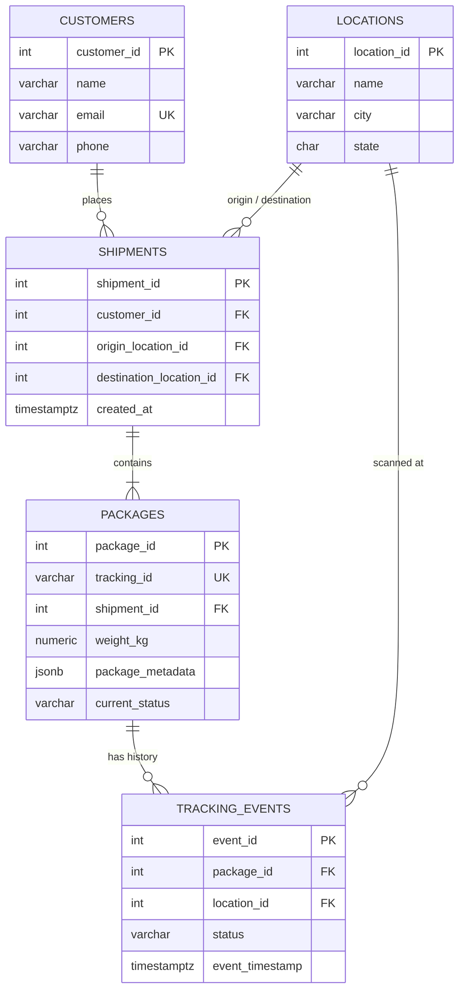

# Logistics & Shipment Tracking Backend

Backend data service for a shipment tracking company. Warehouse and driver scans are recorded transactionally in **PostgreSQL**, the latest package status is cached in **Redis**, and raw scanner logs are kept in **MongoDB** for auditing.

## Quick start

```bash
docker compose up -d
python -m venv .venv
source .venv/bin/activate            # PowerShell: .venv\Scripts\Activate.ps1
pip install -r requirements.txt

# Load schema and sample data
docker compose exec -T postgres psql -U postgres -d logistics < sql/schema.sql
docker compose exec -T postgres psql -U postgres -d logistics < sql/seed.sql

# Run the tests (they also reset all three databases)
python -m pytest -v
```
Uses **psycopg 3** (the successor to psycopg2) with `psycopg-pool` for connection pooling.

Example usage from a Python shell in the project root:

```python
>>> from app.tracking import process_tracking_scan, get_package_status, get_package_history
>>> process_tracking_scan(3, 2, "In Transit", scanner_id="SCN-LOU-01")
{'tracking_id': 'TRK1003', 'status': 'In Transit', 'location': 'Louisville, KY'}
>>> get_package_status("TRK1003")
{'status': 'In Transit', 'location': 'Louisville, KY'}
>>> get_package_history("TRK1001")
```


## Entity-Relationship Diagram



## Schema explanation

| Table | Purpose |
|---|---|
| `customers` | Who sends shipments. |
| `locations` | Warehouses, hubs and stations where packages are scanned. |
| `shipments` | One send request: customer, origin and destination. Contains one or more packages. |
| `packages` | A physical parcel. `tracking_id` is the public number (also used in Redis keys); `package_id` is the internal key. |
| `tracking_events` | Append-only scan history: one row per scan with status, location and time. |

### Normalization (3NF)

- **1NF:** every column is atomic; scan history is its own table rather than a list in `packages`.
- **2NF:** every table has a single-column primary key, so partial dependencies cannot occur.
- **3NF:** no non-key column depends on another non-key column. City and state live only in `locations`, customer details only in `customers`; other tables hold foreign keys.

**Deliberate denormalization: `packages.current_status`.** It duplicates the status of the latest tracking event. It is kept because "what is the status of package X?" is the most frequent read, so it should be a single-row lookup. It can never drift out of sync because it is only updated in the **same transaction** that inserts the tracking event.

**`package_metadata` (JSONB)** stores handling attributes (`fragile`, `requires_signature`) that vary per package, without adding a column for each.

### Constraints

- `NOT NULL` on all required columns; `UNIQUE` on `email` and `tracking_id`.
- `CHECK (weight_kg > 0)` and a `CHECK` on the allowed tracking statuses, so typos are rejected.
- Foreign keys use the default `NO ACTION`, which blocks deleting customers or locations that have history: tracking data is audit data.

## Design decisions

### Scan processing (`process_tracking_scan`)

1. **PostgreSQL transaction:** update `packages.current_status` and insert the tracking event in one ACID transaction. Any error rolls back both.
2. **Redis (after commit):** cache `package:<tracking_id>:status` → `{"status": ..., "location": "City, ST"}` with a 1-hour TTL.
3. **MongoDB (after commit):** store the raw scan (scanner ID, timestamp, metadata).

**Why Redis and MongoDB are written after the commit, on a best-effort basis:** PostgreSQL is the source of truth. If Redis were written inside the transaction, a Redis outage would roll back and lose valid scans, and a failed commit could leave the cache showing a status that never happened. Failures in steps 2 and 3 are logged as warnings rather than raised, because raising would make the scanner retry and record a duplicate event.

### Reading status (cache-aside)

`get_package_status` reads Redis first. On a miss, or if Redis is down, it reads PostgreSQL and refills the cache. The TTL bounds how long a stale value can survive if a cache write ever fails.


## Performance report

**Query:** full tracking history of one package (`get_package_history`): a CTE that finds the package, then uses `LAG()` to compute the time between consecutive scans.

**Dataset:** 100,000 packages × 10 events = **1,000,000 tracking events**, inserted in time order so each package's events are scattered across the table. Script: `sql/queries.sql`.

**Index added:** `CREATE INDEX idx_tracking_events_package_time ON tracking_events (package_id, event_timestamp);`

| | Before index | After index |
|---|---|---|
| Access method on `tracking_events` | Parallel Seq Scan (2 workers) | Bitmap Index Scan |
| Rows read from `tracking_events` | ~1,000,000 | 10 |
| Execution time | **185.3 ms** | **0.50 ms** |

**Result: about 370× faster.**

**Why it works:** without the index, PostgreSQL must read every row in `tracking_events` to find the 10 belonging to one package. The composite index stores rows sorted by `package_id`, then `event_timestamp`, so PostgreSQL jumps straight to that package's entries. `package_id` comes first because the query filters on it with equality; `event_timestamp` second because it orders the results.

**Trade-off:** every scan now also updates the index, adding a small cost to writes. For a tracking system, where history lookups are frequent and each scan inserts only one row, that cost is worth it.

The index is included at the end of `schema.sql`. `queries.sql` drops it before the "before" measurement, so the benchmark stays reproducible.

To reproduce:

```bash
docker compose exec -T postgres psql -U postgres -d logistics < sql/queries.sql
python -m pytest     # resets the database afterwards
```
